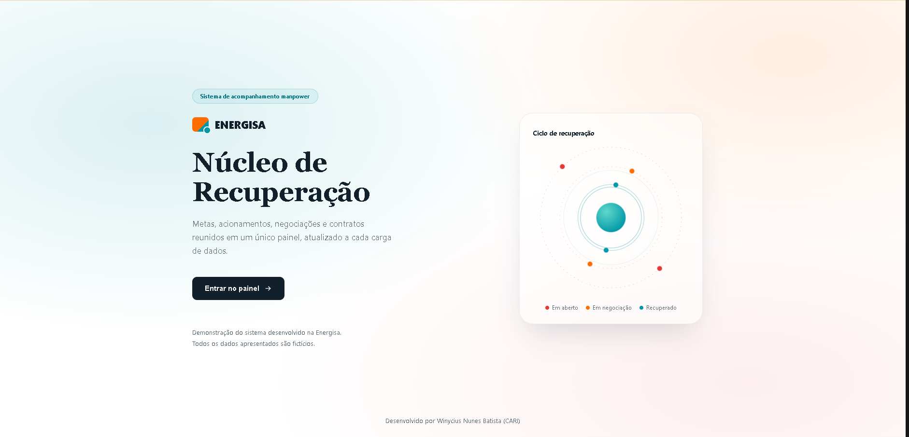
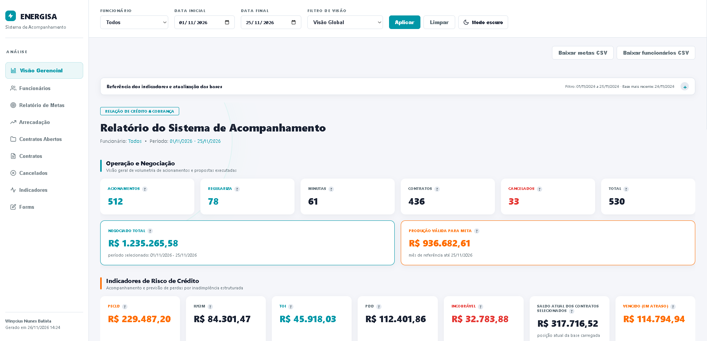
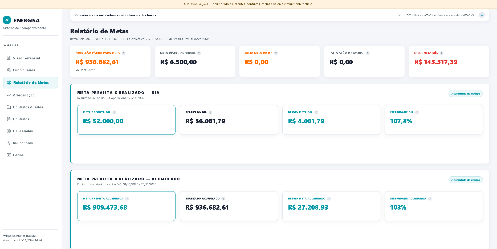

# Manpower - Núcleo de Recuperação

Sistema web desenvolvido e implantado por Winycius Batista durante sua atuação como Aprendiz na Energisa para acompanhar produtividade de colaboradores terceirizados, negociações, recebimentos e metas.

[Voltar ao portfólio profissional](README.md)

## Problema que motivou o projeto

Os registros das atividades eram enviados por formulários e reunidos em planilhas. O analista responsável precisava consolidar informações para consultar o que cada colaborador havia negociado, acompanhar os recebimentos e comparar a produção com as metas.

Identifiquei a necessidade de organizar essas informações em um sistema que permitisse consultar os resultados por colaborador e período.

## Minha atuação

Identifiquei o problema, desenvolvi a solução e realizei sua implantação. Trabalhei no processamento dos dados em Python, na leitura e consolidação das planilhas, nas regras de cálculo dos indicadores e na construção da interface web.

## O que foi construído

- Consolidação de informações de diferentes planilhas e históricos.
- Associação dos registros aos colaboradores responsáveis.
- Acompanhamento de produtividade, negociações e valores arrecadados.
- Comparação entre metas diárias e mensais e a produção realizada.
- Consulta de contratos, minutas, cancelamentos e vencimentos.
- Filtros por colaborador, período e visão dos indicadores.
- Gráficos e relatórios para apoiar o acompanhamento da equipe.
- Exportação de dados e relatórios em CSV, Excel e PDF.
- Atualização programada do painel.

## Como a solução funciona

O processamento em Python lê e consolida as planilhas, aplica as regras dos indicadores e reúne os dados tratados com os componentes visuais em um painel HTML acessado pelo navegador.

A interface utiliza HTML, CSS e JavaScript. A execução pelo servidor local permite realizar a atualização programada e gerar os relatórios em Excel e PDF.

## Tecnologias utilizadas

- **Python:** processamento dos dados e execução das rotinas.
- **Pandas e OpenPyXL:** leitura, tratamento e consolidação de planilhas.
- **ReportLab:** geração de relatórios em PDF.
- **HTML, CSS e JavaScript:** interface web, filtros, gráficos e tabelas.

## Demonstração visual

As imagens abaixo apresentam uma demonstração com colaboradores, clientes, contratos, metas e valores inteiramente fictícios. Os números ilustram as funcionalidades e não representam resultados financeiros reais da empresa.

### Abertura do sistema

### Visão gerencial

Acompanhamento de acionamentos, negociações, contratos e indicadores no período selecionado.

### Acompanhamento de metas

Comparação entre metas e produção realizada, com acompanhamento diário e acumulado da equipe.

## Sobre esta apresentação

Esta página reúne a descrição do projeto e as capturas da demonstração. O código e os dados corporativos permanecem privados.
